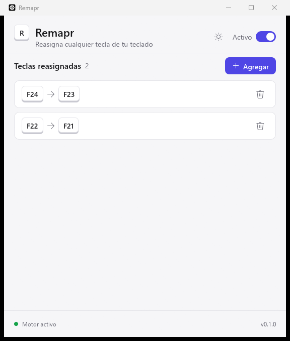
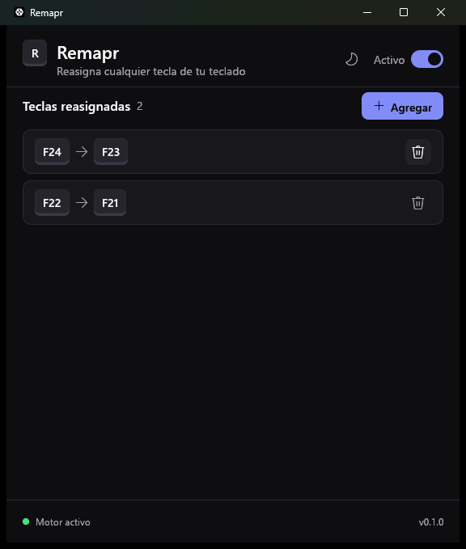

# Remapr

A fast, native key remapper for Windows, written entirely in Rust.

Press a key, press the key it should become, done. No web views, no runtime, no background services
beyond a single small process.

<p align="center">
  
  
</p>

## Features

- Remap any key to any other key, system-wide.
- Add a mapping by pressing the keys, not by picking from a list.
- Pause all remapping with one switch; keys held down while pausing are released correctly.
- Safe with AltGr layouts (Spanish, German, ...): `@`, `#`, `€` keep working.
- Light, dark, or follow Windows, including the native title bar.
- Settings saved to `%APPDATA%\Remapr\config.toml`, written atomically.

See [ROADMAP.md](ROADMAP.md) for what comes next (tray icon, installer, auto-update, shortcuts).

## Requirements

- Windows 10 or 11 (x64).
- Rust 1.95 or newer with the MSVC toolchain: install from [rustup.rs](https://rustup.rs).
- Microsoft C++ Build Tools (the "Desktop development with C++" workload), needed by the MSVC linker.

## Development

Run the app in debug mode:

```sh
cargo run
```

Debug builds keep a console window attached so `println!` and panics are visible. Release builds
have no console.

Run the tests, lints and formatter, the same checks CI runs:

```sh
cargo test --workspace
cargo clippy --workspace --all-targets -- -D warnings
cargo fmt --all --check
```

### Remapping inside admin windows

Windows does not let a normal process change keys typed into elevated windows (Task Manager,
installers, terminals run as administrator). To test that, start your terminal as administrator
before `cargo run`. The installer (phase 3) will set this up automatically for users.

## Building a release

```sh
cargo build --release
```

The executable is `target\release\remapr.exe`. It is self-contained: copy it anywhere and run it.

## Project layout

```
remapr/
├── apps/
│   └── remapr/          The executable: main window, capture flow, settings file
├── crates/
│   ├── engine/          Global keyboard hook and key injection (the only unsafe code)
│   └── ui/              Design system: light/dark tokens, fonts, Kbd, buttons, switch, cards
├── docs/                Screenshots and design notes
└── .github/workflows/   CI
```

Apps depend on crates, never the other way around. Each crate has one job:

- **engine** knows nothing about the UI. It installs a `WH_KEYBOARD_LL` hook on a dedicated
  high-priority thread, swaps keys through `SendInput`, and exposes a small API (`set_mappings`,
  `set_enabled`, `start_capture`). The decision for each key event is plain Rust in `remap.rs`,
  unit-tested without Windows.
- **ui** knows nothing about keys. Screens take every colour from `Palette` and every font from
  the theme, so light and dark mode stay consistent. It uses the fonts already on Windows
  (Segoe UI and Segoe Fluent Icons), which adds nothing to the binary.
- **apps/remapr** wires the two together and owns the settings file.

## How it works

Windows sends every key press to the hook before any application sees it. If the key is mapped,
Remapr swallows it and injects the target key instead. Injected keys are ignored by the hook, so a
mapping can never loop. The callback only reads atomics and a fixed table: no locks, allocation or
I/O, which keeps added latency in the microseconds.

## License

[MIT](LICENSE). You can use, modify and redistribute Remapr, including commercially, as long as
you keep the copyright notice and credit Brad Moyetones as the original author.
